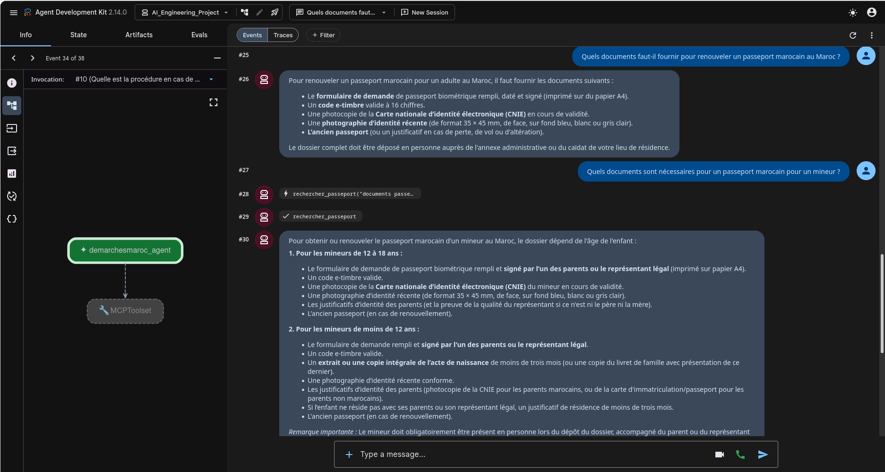
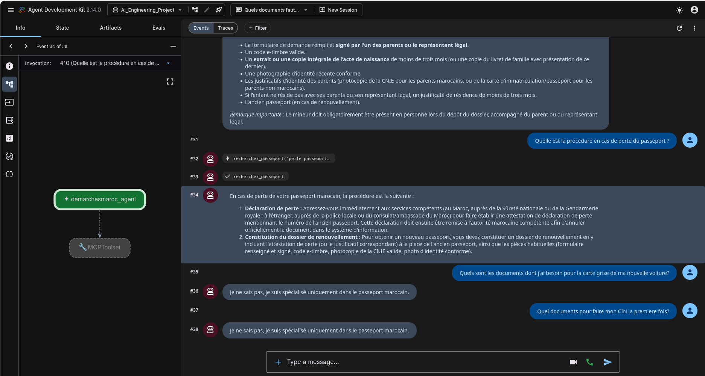

# Assistant intelligent pour les démarches du passeport marocain

## Présentation

Ce projet consiste à développer un assistant conversationnel intelligent spécialisé dans les démarches administratives liées au passeport marocain.

L'assistant utilise une architecture **RAG (Retrieval-Augmented Generation)** afin de fournir des réponses fondées sur un corpus documentaire consacré aux procédures du passeport marocain.

Il permet notamment de répondre aux questions concernant :

- Les premières demandes et les renouvellements.
- Les documents à fournir selon la situation du demandeur.
- Les démarches pour les mineurs.
- Les cas de perte ou de vol.
- Les tarifs et les délais, lorsque les informations sont disponibles.

## Structure du projet

```text
AI_Engineering_Project/
│
├── corpus/                      # Pages sources en texte brut
├── screenshots/                 # Captures de l'application
│
├── scrape_corpus.py             # Collecte des pages
├── verifier_corpus.py           # Vérification du corpus
├── chunking.py                  # Découpage en chunks
├── embeddings.py                # Génération des embeddings
├── indexer.py                   # Indexation dans Pinecone
├── rag.py                       # Pipeline RAG et génération des réponses
├── config.py                    # Configuration Gemini
├── prompt.py                    # System prompt
├── partie_a.py                  # Tests de prompting
│
├── serveur_mcp.py                # Serveur MCP
├── client_mcp.py                 # Client de test MCP
├── agent.py                      # Agent Google ADK
│
├── tester_rag.py                 # Tests du retrieval et du RAG
├── evaluation_rag.py             # Évaluation RAG
├── evaluation_retrieval.py       # Évaluation du retrieval
├── evaluation_performance.py     # Évaluation des performances
├── rapport_evaluation.py         # Rapport d'évaluation
│
├── requirements.txt
├── .gitignore
└── README.md
```

## Architecture du projet

1. **Collecte documentaire** : extraction des informations depuis les pages web consacrées au passeport marocain.
2. **Prétraitement** : nettoyage et découpage des documents en passages.
3. **Vectorisation** : transformation des passages en embeddings.
4. **Indexation** : stockage des vecteurs et métadonnées dans Pinecone.
5. **Récupération** : recherche des passages pertinents à partir de la question.
6. **Génération** : Gemini produit une réponse fondée sur le contexte récupéré.
7. **Orchestration** : Google ADK utilise le serveur MCP pour interroger le système RAG.

## Architecture et technologies

Le projet repose sur les composants suivants :

- **Python** : développement de l'application.
- **Google Gemini** : génération des réponses.
- **Google ADK** : création et orchestration de l'agent intelligent.
- **MCP (Model Context Protocol)** : exposition des fonctionnalités RAG sous forme d'outils.
- **Pinecone** : stockage et recherche vectorielle.
- **Gemini Embedding** : vectorisation des documents.
- **RAG** : récupération des passages pertinents avant la génération des réponses.

```text
Utilisateur
    |
    v
Google ADK (Agent)
    |
    v
Serveur MCP
    |
    v
Système RAG
    |
    +---- Embedding de la question
    |
    +---- Recherche vectorielle (Pinecone)
    |
    +---- Récupération du contexte
    |
    v
Google Gemini
    |
    v
Réponse à l'utilisateur
```

## Évaluation

Le projet comprend plusieurs scripts dédiés à l'évaluation :

- Évaluation de la qualité des réponses RAG.
- Évaluation de la pertinence des passages récupérés.
- Évaluation des performances du système.

## Tests de l'agent

L'agent a été testé sur trois questions relatives au passeport marocain et deux questions hors sujet.

| #   | Question                                                                     | Résultat obtenu                                                           | Évaluation |
| --- | ---------------------------------------------------------------------------- | ------------------------------------------------------------------------- | ---------- |
| 1   | Quels documents fournir pour renouveler un passeport marocain au Maroc ?     | Liste des documents nécessaires au renouvellement.                        | Correct    |
| 2   | Quels documents sont nécessaires pour un passeport marocain pour un mineur ? | Documents adaptés à l'âge du mineur.                                      | Correct    |
| 3   | Quelle est la procédure en cas de perte du passeport ?                       | Explication des démarches et des justificatifs nécessaires.               | Correct    |
| 4   | Quels documents pour la carte grise d'une nouvelle voiture ?                 | Je ne sais pas, je suis spécialisé uniquement dans le passeport marocain. | Correct    |
| 5   | Quels documents pour obtenir une CIN pour la première fois ?                 | Je ne sais pas, je suis spécialisé uniquement dans le passeport marocain. | Correct    |

Les trois premières questions vérifient la capacité de récupération documentaire (RAG). Les deux dernières vérifient le respect du périmètre de spécialisation de l'agent.

## Démonstration

L'interface Google ADK Web permet de tester l'agent et d'interagir avec lui.





## Installation et exécution

### 1. Cloner le projet

```bash
git clone https://github.com/amtorigami/AI_Engineering_Project.git
cd AI_Engineering_Project
```

### 2. Créer un environnement virtuel

```bash
python -m venv rag_venv
source rag_venv/bin/activate
```

### 3. Installer les dépendances

```bash
pip install -r requirements.txt
```

### 4. Configurer les variables d'environnement

Créer un fichier `.env` à la racine du projet :

```env
GEMINI_API_KEY=your_gemini_api_key
PINECONE_API_KEY=your_pinecone_api_key
```

### 5. Préparer la base vectorielle

Exécuter les scripts de collecte, de prétraitement, de vectorisation et d'indexation, si la base Pinecone n'est pas déjà préparée.

### 6. Lancer l'agent

```bash
adk web
```

Ouvrir ensuite :

`http://127.0.0.1:8000`

## Réponses aux questions bonus

- Bonus Partie A : hallucination

Un cas à risque apparaît lorsqu'un utilisateur demande le coût ou le délai de renouvellement du passeport. Le modèle pourrait inventer un montant ou un délai si ces informations ne figurent pas dans le contexte. Pour limiter ce risque, j'ai renforcé le prompt en imposant au modèle de répondre exclusivement à partir des passages récupérés et de signaler explicitement toute information absente.

- Bonus Partie B : métrique RAG

J'ai évalué la pertinence de la recherche à partir des scores de similarité cosinus et des sources retrouvées pour chaque question. Cette première évaluation permet de vérifier que les passages récupérés sont liés au sujet demandé. Elle ne constitue toutefois pas une mesure formelle de faithfulness ou de precision@k.
